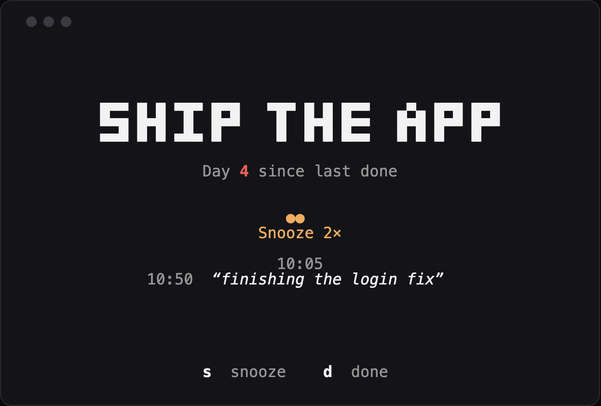

# Tally

**A terminal scoreboard for the numbers that move you.** Tally counts what's already in your data (notes, log files, repos, APIs, any command) and shows it in one panel: what you've invoiced this month, what you shipped today, how long since a client heard from you, what to do next.

It never stores or edits anything. It only counts.

```
        ████████╗ █████╗ ██╗     ██╗     ██╗   ██╗
        ╚══██╔══╝██╔══██╗██║     ██║     ╚██╗ ██╔╝
           ██║   ███████║██║     ██║      ╚████╔╝
           ██║   ██╔══██║██║     ██║       ╚██╔╝
           ██║   ██║  ██║███████╗███████╗   ██║
           ╚═╝   ╚═╝  ╚═╝╚══════╝╚══════╝   ╚═╝
                    thursday 19 march
  ╭─ Invoiced In March ────────────────────────────────╮
  │ $5,200 of $8,000                               65% │
  │ ████████████████████████████████░░░░░░░░░░░░░░░░░░ │
  ╰────────────────────────────────────────────────────╯
  ╭─ ▶ Today ─────────╮ ╭─ ▶ This Week ────────────────╮
  │ ✓ drafted       1 │ │ drafted                    2 │
  │ ○ delivered     0 │ │ delivered                  1 │
  │ ○ invoiced      0 │ │ invoiced                   1 │
  │                   │ │ since delivery            1d │
  ╰───────────────────╯ ╰──────────────────────────────╯
  ╭─ Clients ──────────────────────────────────────────╮
  │      3         $3,700         1          today     │
  │  quotes out    quoted     sent today     idle      │
  ╰────────────────────────────────────────────────────╯
  ╭─ Next ─────────────────────────────────────────────╮
  │ → Deliver Acme logo refresh                        │
  │ → Chase Initech                                    │
  ╰────────────────────────────────────────────────────╯
  q close · h hide
```

Built for people who live in the terminal and keep drifting into the wrong work. Put the numbers that matter where you start your day.

- **Your data, your sources.** Folders of markdown notes (Obsidian works), CSV or markdown logs, JSON exports, any JSON API, git repos, or any command that prints a number.
- **Opens instantly.** The last result shows at once; fresh numbers replace it as they load.
- **`h` hides money and names** for screen sharing or filming. It's remembered between opens.
- **Spur**, an optional nudge, pops up while you work in Claude Code until today's one thing is done.
- **No dependencies.** Node 20 or newer.

**Spur** is Tally's nudge: a popup that interrupts your Claude Code sessions until today's one thing is done, then leaves you alone. [More below](#spur).

<p align="center"></p>

## Install

```sh
git clone https://github.com/jordadew/tally.git
cd tally && npm link        # puts `tally` on your PATH
```

Try it on made-up data first:

```sh
node examples/demo/make.mjs
tally --config examples/freelancer.json
```

## Set up

Two ways to make your own `~/.config/tally/config.json`:

**Guided, in Claude Code (recommended).** It works out what you want to be pushed toward, finds where your data lives, helps pick the few numbers worth showing, and lets you try layouts before saving.

```sh
mkdir -p ~/.claude/skills && cp -r skills/tally-setup ~/.claude/skills/
```

Then in Claude Code: `/tally-setup`.

**Quick, in the terminal:** `tally init`. It asks what to tally and where each thing lives, shows a live count as you answer, then writes the config.

**No data anywhere yet?** Tally only counts, so it needs a home for the data. The simplest is a markdown log you add a line to, which `tally init` can create for you:

```
- 2026-03-19 Chased Initech
- 2026-03-19 1000 Initech
```

## Commands

| Command | Does |
|---|---|
| `tally` | Open the panel. `q` or `Esc` closes, `h` hides sensitive numbers |
| `tally --once` | Print the panel once and exit |
| `tally --daily` | Open only if it hasn't been shown today (for startup hooks) |
| `tally check` | Read every number and print its value, or the error, with timing |
| `tally preview` | Try layouts: `Tab` picks a section, `↑` `↓` changes its layout, `w` saves (old config kept as `.bak`). `--sample` uses made-up numbers |
| `tally init` | Set up a config with questions |
| `tally spur` | Spur, the nudge ([below](#spur)) |

Options: `--config <path>` (or `$TALLY_CONFIG`), `--close-key <letter>` (ctrl+letter also closes).

## Config

```json
{
  "title": "TALLY",
  "currency": "$",
  "weekStart": "monday",
  "sections": [ { "title": "Invoiced in {month}", "layout": "progress", "metric": "invoiced", "target": 8000 } ],
  "metrics": {
    "invoiced": {
      "label": "invoiced", "format": "money", "sensitive": true,
      "source": { "type": "file", "path": "~/notes/invoices.csv", "pattern": "^(?<date>[\\d-]+),[^,]*,(?<amount>[\\d.]+)$", "window": "month", "measure": "sum", "field": "amount" }
    }
  }
}
```

Paths can start with `~`; relative paths are relative to the config file. [`examples/freelancer.json`](examples/freelancer.json) uses every feature.

### Top level

| Key | Default | |
|---|---|---|
| `title` | `"TALLY"` | Any other text shows as a plain heading instead of the banner |
| `banner` | | Your own ASCII art as an array of lines, or `false` for none |
| `currency` | `"$"` | For `money` numbers |
| `weekStart` | `"monday"` | Or `"sunday"` |
| `width` | `54` | Panel width in characters |
| `locale` | `"en-GB"` | Number and date formatting |

### Sections

Every section has a `layout`. Titles can use `{month}`, `{weekday}` and `{date}`.

| Layout | Keys | Shows |
|---|---|---|
| `strip` | `title`, `metrics` | 2–5 numbers in a row, label under each |
| `rows` | `title`, `metrics` | One per line, with each metric's `detail` on the right |
| `pair` | `left`, `right`: `{ title, metrics, ticks }`, optional `ratio` | Two boxes side by side, e.g. today beside this week. `ticks: true` adds ✓ / ○ |
| `progress` | `title`, `metric`, `target` | One number against a target, with a bar |
| `list` | `title`, `metrics` | Next actions from text values (see `template`, `empty`) |

### Metrics

| Key | |
|---|---|
| `source` | Where the number comes from (below). Required |
| `label` | Shown under or beside the number |
| `format` | `number` (default), `money`, `days` (`4d`, `today`), `percent` |
| `tone` | Colour rules, checked red, then amber, then green: `{ "red": ">= 5", "amber": ">= 2", "green": "> 0" }` |
| `sensitive` | `true` → hidden by `h` |
| `detail` | Extra text on the right in `rows` |
| `template`, `empty`, `max` | For `list`: `"Reply to {value}"`, text when there's nothing, how many lines |

### Sources

| `type` | Keys | Reads |
|---|---|---|
| `folder` | `path`, `ext` (`.md`) | One row per note, from its frontmatter (plus `title` from the filename) |
| `file` | `path`, `pattern`, `flags` | One row per line matching the regex. Named groups become fields; `(?<date>…)` makes windows work |
| `json` | `path`, `key` | A value at `key` (e.g. `quotes[0].amount`), or an array to count |
| `http` | `url`, `headers`, `key`, `envFile`, `timeout` | A JSON API. Use `${ENV_VAR}` in `url` and `headers`; keys never go in the config |
| `git` | `repo`, `author`, `path` | One row per commit |
| `command` | `run`, `parse` (`number`, `lines`, `text`, `json`), `key`, `envFile`, `timeout` | Anything with a CLI |

Rows from `folder`, `file`, `json`, `http` and `git` are narrowed and measured with:

| Key | |
|---|---|
| `where` | Keep rows whose field equals a value, or any of a list: `{ "status": ["open", "pending"] }` |
| `date` | Which field holds the date (`mtime` = file changed, for `folder`) |
| `window` | `today`, `week`, `month` (needs `date`) |
| `measure` | `count` (default), `sum` (with `field`), `days_since`, `latest`, `first` (with `field`, `sort`) |
| `sort` | For `first`: `{ "field": "status", "order": "desc" }`, or `"rank": ["drafted", "briefed"]` for a custom order |

## Put it where you work

**tmux:** a popup on `prefix T`:

```tmux
bind T display-popup -E -w 62 -h 36 "tally --close-key t"
```

**[herdr](https://herdr.dev):**

```sh
herdr plugin install jordadew/tally/herdr
```

then bind a key in `~/.config/herdr/config.toml`:

```toml
[[keys.command]]
key = "prefix+$"          # or "ctrl+t" (that takes ctrl+t from every pane)
type = "plugin_action"
command = "tally.open"
description = "Tally"
```

**Once a day, automatically:** add `tally --daily` to your `~/.zshrc` or `~/.bashrc` (inside an interactive-shell check), or run it from a Claude Code `SessionStart` hook so it appears the first time you start working. In herdr, have the hook run `herdr plugin pane open --plugin tally --entrypoint panel` instead, after checking that `$HERDR_PANE_ID` is set.

## Spur

Spur is Tally's nudge. While you work in Claude Code, it pops up (in herdr or tmux) until today's one thing is done, then leaves you alone for the day. The only ways out are to snooze, which it counts, or to get it done.

<p align="center">
  
  
</p>

It opens with a short title animation and sound, then shows your prompt. When it's done, the prompt is struck through, bursts, and DONE stamps in.

**What counts as done** is one of your Tally numbers: once it's above 0 today, Spur stops for the day (and an open popup closes itself within a minute). Or press `d`. The "Day N" line comes from a days-since number, or from your last `d`.

```json
"spur": { "prompt": "SHIP THE APP", "done": "commits_today", "since": "since_commit" }
```

### Set up

1. **The prompt:** `tally spur setup` (or the last step of `tally init`, or `/tally-setup spur` in Claude Code, which helps you work out the one thing and word it). Verb first, short and clear: SHIP THE APP, SEND PITCHES, GO TO THE GYM.
2. **Sounds:** `tally spur sounds`. Tally doesn't ship any audio; this downloads each sound from where its author published it (Freesound, Mixkit) and builds Spur's sounds on your machine. Needs [ffmpeg](https://ffmpeg.org) (`brew install ffmpeg`, `sudo apt install ffmpeg`). Credits and licences: [`spur/CREDITS.md`](spur/CREDITS.md).
3. **The trigger:** `tally spur install` adds a prompt hook to Claude Code's `~/.claude/settings.json`. It shows the change and asks first; `tally spur uninstall` takes it out.
4. **See it:** `tally spur test`. In herdr, Spur needs the plugin above (`herdr plugin install jordadew/tally/herdr`).

### How it decides

| | |
|---|---|
| Work day | Starts at your first prompt after a 5-hour break, so a late night still counts as the day before |
| First nudge | 45 min after that first prompt |
| Snooze | `s` snoozes 45 min. From the 2nd snooze of the day it asks why, and lists your reasons back to you |
| Cutoff | None by default; pick 20:00, 21:30, 23:00 or type your own time to stop new nudges after it |
| Keys | `s` snooze, `d` done; `m` mutes, `r` replays the intro |
| Sound | Never 22:00–08:00. `m` mutes, or turn sound off in edit |

| Command | Does |
|---|---|
| `tally spur setup` | First time: a few questions. After that a status screen; `e` opens edit, every setting on one page (`←` `→` changes it), `t` tests |
| `tally spur test` | The popup, recording nothing (`q` closes) |
| `tally spur check --why --dry` | What a prompt would do right now, without changing anything |
| `tally spur focus "SHIP THE APP"` | Set the prompt |

## Privacy

Tally reads local files and the sources you configure, and nothing else. It sends nothing anywhere. The one download is `tally spur sounds`, which fetches Spur's sounds from Freesound and Mixkit. The last result is kept in `~/.local/state/tally/` so the next open is instant; Spur's snoozes and days live there too.

## License

MIT
